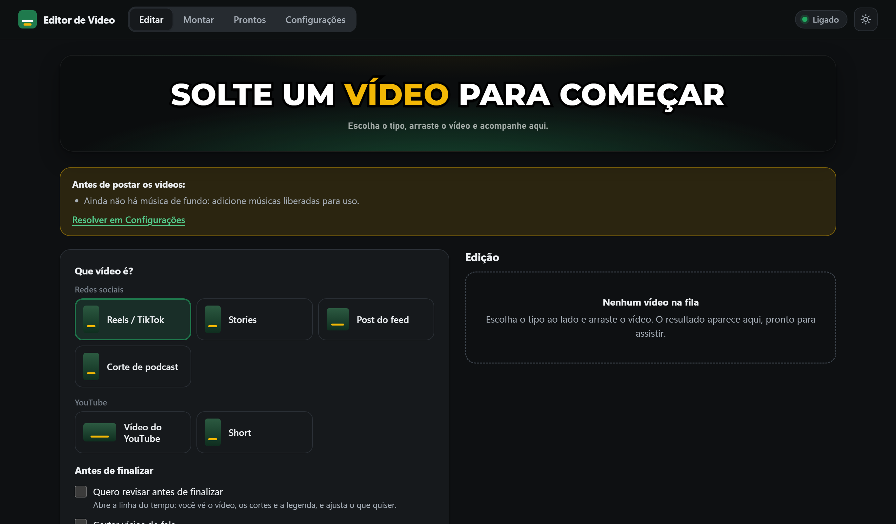
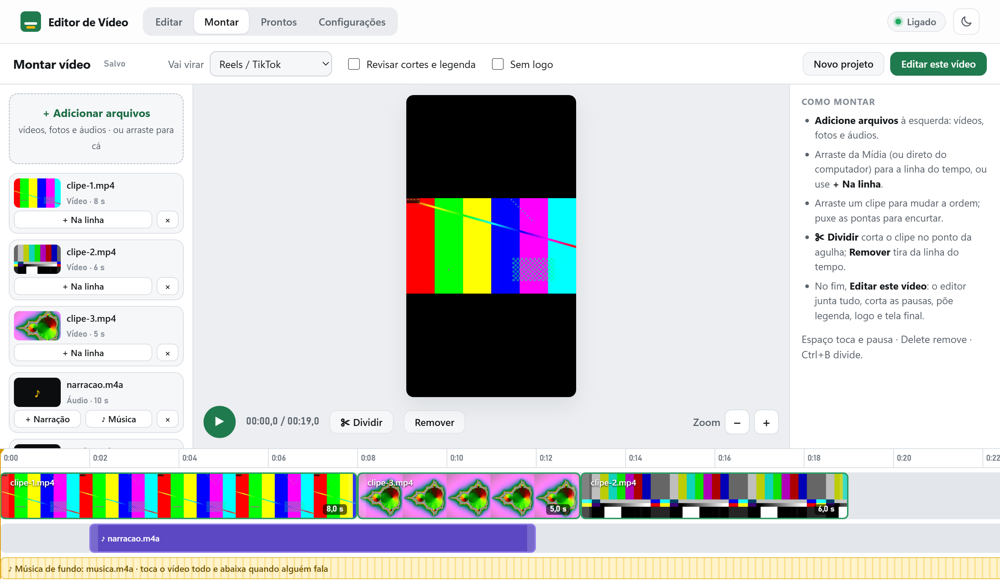
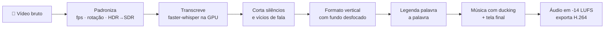

# 🎬 Editor de vídeo local

Solte um vídeo bruto gravado no celular e ele sai **pronto para Reels/TikTok, Stories, Feed, corte de podcast ou YouTube**: sem silêncios, com legenda palavra a palavra, música com volume automático e tela final. Tudo **no próprio computador**, sem mandar nada para a nuvem.

Tem uma página local com fila de edição, revisão na linha do tempo e um **modo de montagem estilo CapCut**.

  
  

---

## ✨ O que ele faz sozinho

- **Corta silêncios e vícios de fala** ("hã", "né") com precisão de quadro, sem dessincronizar áudio e vídeo.
- **Legendas estilo TikTok** palavra a palavra, com destaque e animação.
- **Música com ducking:** a trilha abaixa sozinha quando alguém fala.
- **Áudio no padrão das redes** (-14 LUFS, loudnorm em 2 passadas).
- **Modo YouTube:** gera a legenda `.srt`, fotos para a thumbnail e **escolhe sozinho os 3 melhores trechos para Shorts** (nota por ganchos, números e ritmo).

## 🖥️ A página local

- **Editar:** arraste o vídeo, escolha o tipo e acompanhe a fila. Com "Quero revisar", abre uma **linha do tempo** com miniaturas, forma de onda, cortes sugeridos e legendas editáveis.
- **Montar:** editor estilo CapCut, com faixas de vídeo/foto, narração e música. Dá para dividir, encurtar e reordenar.
- **Prontos** e **Configurações** (logo, tela final, músicas), com tema claro e escuro.
- Também **vigia a pasta `entrada/`**: o vídeo que cai nela é editado sozinho.

## 🔧 Destaques técnicos

- Cortes alinhados por quadro e por amostra de áudio (trim/atrim em 48000/fps), com as legendas reposicionadas na nova linha do tempo.
- Legendas corrigidas à mão são realinhadas com os tempos de cada palavra (difflib).
- Cache da transcrição por hash: reeditar o mesmo vídeo não transcreve de novo.
- Montagem multipista que protege fotos e clipes sem fala do corte de pausas.
- Servidor HTTP próprio, sem framework: aceita uploads de vários GB em streaming, serve vídeo com HTTP Range e bloqueia pedidos vindos de outros sites.

## 🧰 Tecnologias

Python · FFmpeg (filter_complex, ass, xfade, sidechaincompress, loudnorm) · faster-whisper / CTranslate2 (CUDA) · Pillow · NumPy · PyYAML · HTML/CSS/JS puro (Canvas)

## 🚀 Como rodar (Windows)

1. Instale o Python 3.11+ (`winget install Python.Python.3.12`).
2. Dê dois cliques em `instalar.bat`. Ele:
   - instala o ffmpeg se faltar;
   - cria o `.venv` e instala as dependências (inclusive as de GPU, se achar placa NVIDIA);
   - baixa o modelo Whisper.
3. Dê dois cliques em `Abrir Editor.bat`. A página abre em http://localhost:8765.

Pela linha de comando: `python editar.py entrada/video.mp4 --preset reels`

> Músicas de fundo não vêm no repositório. Adicione músicas liberadas para uso em Configurações.

## 📄 Licença

MIT. A fonte Montserrat segue a licença OFL (`assets/fontes`).
